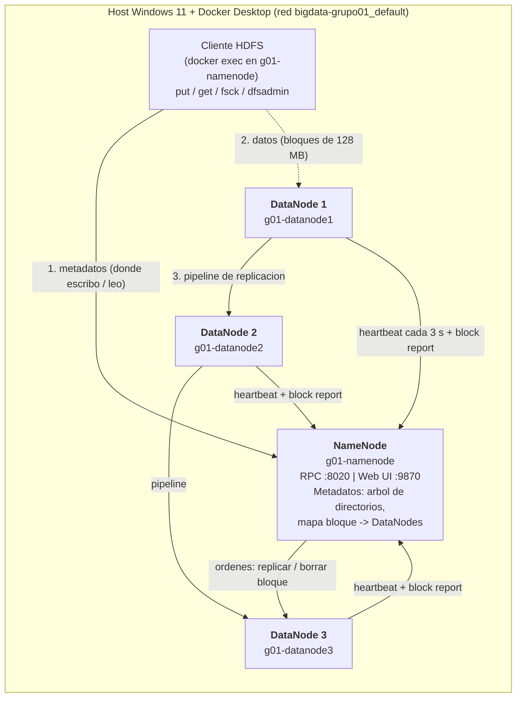

# Diagrama de arquitectura - Grupo 01



## Parametros relevantes (config.env)

| Parametro | Valor | Motivo |
|---|---|---|
| `dfs.replication` | 2 | Requisito de la practica (>= 2) |
| `dfs.blocksize` | 134217728 (128 MB) | 1 GB = 8 bloques, 10 GB = 80 bloques |
| `dfs.heartbeat.interval` | 3 s | Valor por defecto |
| `dfs.namenode.heartbeat.recheck-interval` | 10000 ms | Baja el tiempo de deteccion de nodo muerto de ~10,5 min a ~50 s: `2 x recheck + 10 x heartbeat` |

## Rutas en HDFS

```
/grupo01/dataset_1GB/dataset_grupo01_1GB
/grupo01/dataset_10GB/dataset_grupo01_10GB
/grupo01/resultados/
/grupo01/evidencias/
```
